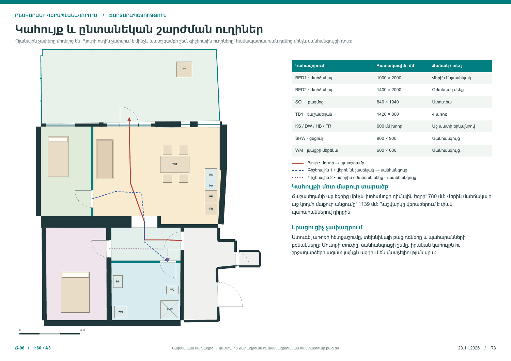
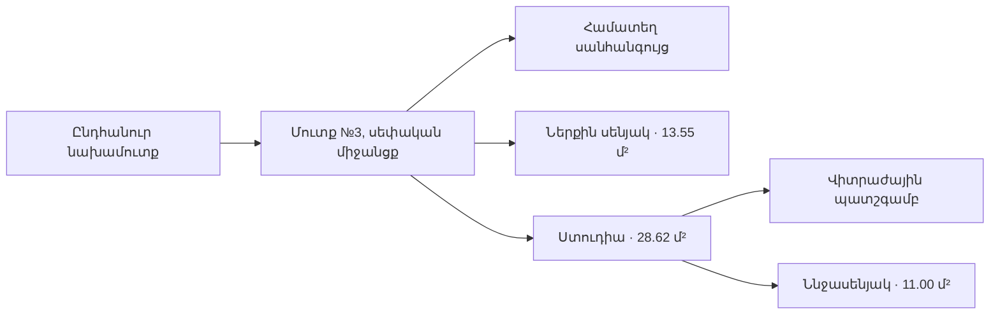
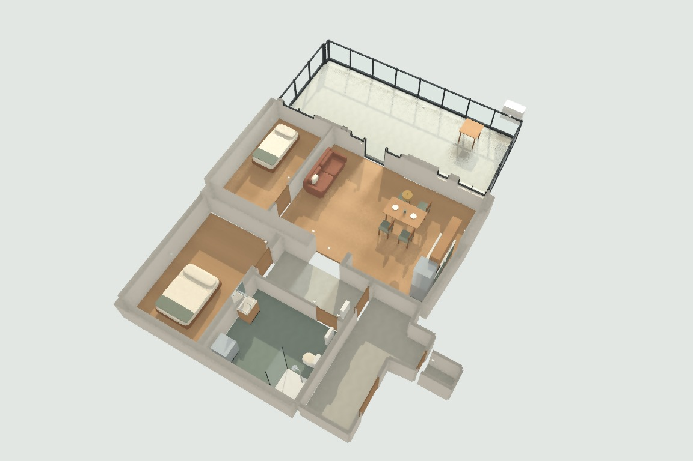

# Բնակարանի վերապլանավորում և ինժեներական նախագծում

Բնակելի նախագծի մասնավոր աշխատանքային պահոց։ Այստեղ պահվում են սկզբնաղբյուրը, չափագրելի հատակագծերը, տարածքների հաշվարկները, կառուցվածքային սահմանափակումները և ինժեներական լուծումների ստուգումները։ Գործող ճյուղը՝ `main`։

**R3 · Պատվիրատուի ընտրված էսքիզ · 24 նոյեմբերի 2026 թ.** Մուտք №3-ից բնակարան մտնելիս բացվում է **5.58 մ² սեփական միջանցքը**։ Պատշգամբի կողմում են **28.62 մ² միասնական հյուրասենյակ-խոհանոցը** և **11.00 մ² լուսավոր ննջասենյակը**։ Ստորին **13.55 մ² սենյակը պատուհան չունի**․ պատվիրատուն այն օգտագործելու է քնելու համար։ Գծագրերում այն ներքին օժանդակ սենք է։ Համատեղ սանհանգույցը **9.62 մ²** է։

[Միասնական PDF գծագրաշար](Բնակարանի%20նախագիծ.pdf) · [Երեք տարբերակների պատկերներ և համակարգերի դիագրամներ](docs/DIAGRAMS.md) · [Նախագծման հիմքեր, թվեր և նորմեր](docs/DESIGN-BASIS.md) · [Մակերեսների մատյան](03-calculations/Areas.xlsx)

[Ընտրված էսքիզ և պատվիրատուի որոշում](docs/SKETCH-REVIEW.md) · [Հանձնման ֆայլացանկ](docs/FILES.md) · [Աշխատանքի շարունակման հուշում](docs/CONTINUE.md)

## Ինչից սկսել

| Ընթերցող | Փաստաթուղթ | Ինչ է պարունակում |
|---|---|---|
| Պատվիրատու | [Գործող տեխնիկական պահանջներ](docs/REQUIREMENTS.md) | Սենյակների կազմը, ընդունման չափանիշները, պարտադիր պահպանվող տարրերը։ |
| Ճարտարապետ և չափագրող | [Ելակետային գեոմետրիա](01-source/base.json) և [կողերի մատյան](01-source/edges.csv) | Թվայնացված սկզբնական ուրվագծեր, կանգնակ, հենակետեր, PDF-ից ստացված չափեր։ |
| Նախագծողներ | [Համակարգման և փոփոխությունների կարգ](CONTRIBUTING.md) | Միավորներ, չափերի աղբյուր, նախագծային որոշման գրանցում և վերաստուգում։ |
| Նախագծի պատասխանատու | [Թողարկումների պատմություն](CHANGELOG.md) | Ըստ վերանայման՝ ինչ պահանջ է փոխվել և ինչ կարգավիճակ ունի նյութը։ |

## Պահոցի կառուցվածք

| Բաժին | Բովանդակություն |
|---|---|
| [00-input](00-input/) | Պատվիրատուի հանձնած նշումներով PDF-ը և սկզբնական տեխնիկական առաջադրանքը՝ անփոփոխ։ |
| [01-source](01-source/) | Առկա վիճակի թվային վերակազմություն, կողմերի հաշվարկ և վերարտադրման կոդ։ |
| [02-design](02-design/) | Մուտքային այլընտրանքներ, տարածքների դասավորություն, ճարտարապետական ալբոմ ու տվյալների բնօրինակ։ |
| [03-calculations](03-calculations/) | Excel-ի միջոցով վերահաշվարկվող մատյան և պատահատվածների աղյուսակներ։ |
| [04-services](04-services/) | Ջրամատակարարում, կոյուղի, էլեկտրասնուցում, լուսավորություն և HVAC՝ սեփական վերանայման համարներով։ |
| [05-model](05-model/) | IFC4 մոդել, անցանց եռաչափ դիտիչ, մոդելի և տեսարանների խմբագրվող բնօրինակներ։ |
| [06-cad](06-cad/) | Ութ խմբագրվող DWG, ութ համապատասխան DXF, շերտեր և հարաբերական արտաքին հղումներ։ |
| [07-views](07-views/) | Մոդելի ութ տեսախցիկ, առանձին JPEG-ներ և տպագրական տեսարանների ալբոմ։ |
| [08-review](08-review/) | Երկրաչափության ստուգում, սահմանային պայմաններ և մասնագիտական համակարգման արձանագրություններ։ |
| [tools](tools/) | Գծագրերի արտադրման և հսկիչ հաշվարկների վերարտադրելի գործիքներ։ |

## Չափման համակարգ

Ընթերցումը սկսեք միասնական 36-էջանոց ալբոմից։ Ընտրված №3-ի կահավորված հատակագիծը էջ 12-ում է, էլեկտրական վահանակը՝ էջ 23-ում, ճակատը և վերևից կտրվածքը՝ էջեր 35–36-ում։ Ինտերակտիվ դիտման համար ներբեռնեք [HTML ֆայլը](05-model/Viewer.html) և բացեք ձեր զննարկիչում։ Մասնագիտական աշխատանքի համար ներբեռնեք [CAD պանակն ամբողջությամբ](06-cad/) կամ բացեք [IFC4 մոդելը](05-model/apartment.ifc)։ Ֆայլերի ստեղծման միջավայրերն ու վերաընթերցման արդյունքները գրանցված են [հանձնման արձանագրությունում](08-review/DELIVERY.md)։

Գծագրային միակ ելակետը նշումներով PDF-ի առաջին էջն է։ Սկզբնակետը հյուրասենյակի ստորին՝ 5.92 մ կրող պատի ձախ ծայրն է։ X-ն աճում է թերթով դեպի աջ, Y-ը՝ վեր, Z-ը՝ հատակից վեր։ JSON կոորդինատները մետրերով են։ CAD-ի միավորը նշվում է համապատասխան արտահանման ուղեցույցում։ Թերթի վերևի ուղղությունը աշխարհագրական հյուսիս չի նշանակում։

Հինգ ներքին սենքերի մակագրված գումարը 66.15 մ² է։ Թվայնացված մաքուր բազմանկյունները տալիս են մոտ 66.18 մ²։ Ընդհանուր նախամուտքը, նախկին փոքր զուգարանը և պատշգամբը ենթակա են առանձին հաշվառման։ Գրանցված սեփականության մակերեսը պարզվում է կադաստրային փաստաթղթով։

## Թողարկման կարգավիճակը

PDF-ից հաստատվող նշանները, պատվիրատուի պահանջները, նախնական ենթադրությունները և հաշվարկները առանձին են գրանցվում։ Շինարարության թողարկման համար պահանջվում են փաստացի չափագրություն, կառուցվածքային ու ինժեներական ստուգումներ և հասցեով կիրառելի համաձայնեցումներ։

Գծագրում առաջնահերթ ճշտման ենթակա են կրող պատի գործող անցքը, սյան հատույթը, կոյուղու կանգնակի միացման նիշը, հորանները, էլեկտրական մուտքը, հարակից հարկերի խոնավ գոտիները և ճակատի բնական լուսավորությունը։
