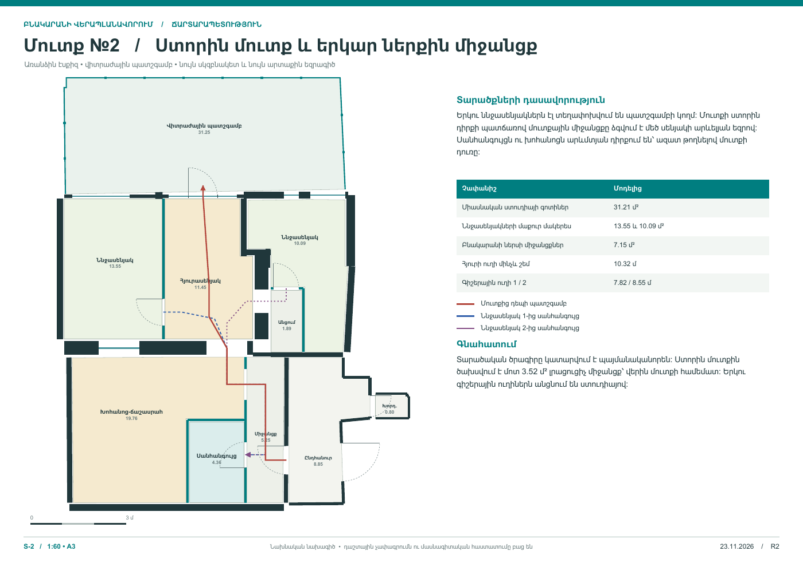
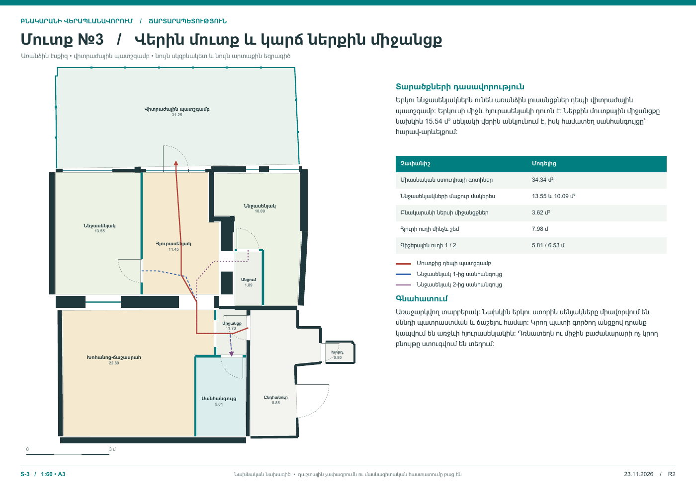
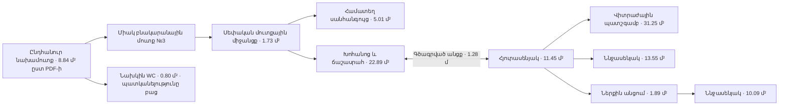
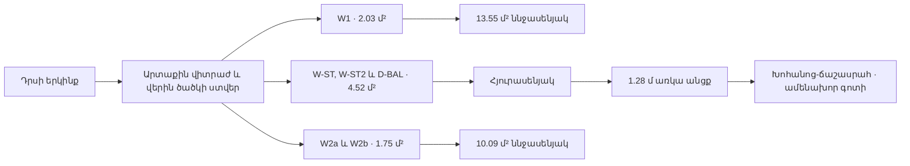
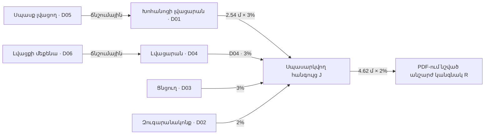
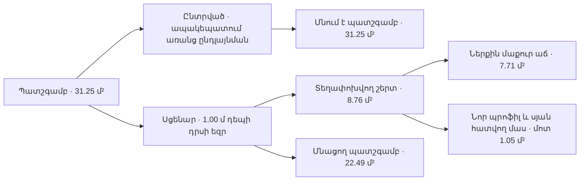
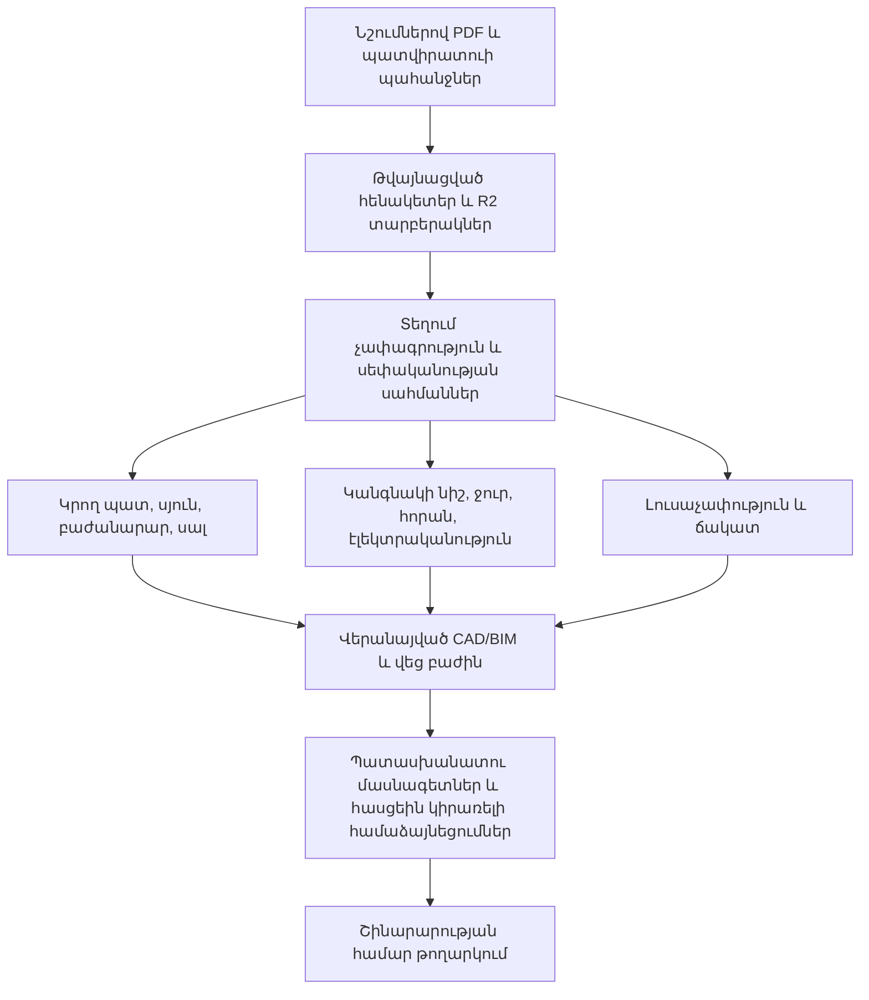

# Դիագրամներ և համեմատելի հատակագծեր

Երեք հատակագծերը արտահանված են նույն գեոմետրիայից, նույն մասշտաբով։ Կարմիր գիծը հյուրի, կապույտն ու մանուշակագույնը՝ երկու ննջասենյակներից սանհանգույց տանող ճանապարհներն են։ Թվային կոորդինատներն ու գծերի բոլոր բեկումները հասանելի են [տարբերակների թղթապանակում](../02-design/options/)։

### №1 · գործող մուտք և հետնամասի սենյակ

### №2 · ստորին մուտք և ավելի երկար սեփական միջանցք

### №3 · առաջարկվող վերին մուտք

## Տարածքների կապը

## Բնական լույսի ճանապարհը

Կրող պատը սահմանափակում է լույսի թափանցումը խոհանոց։ Դռնատեղի բնույթը, սալի դուրսցցվածքը, արտաքին հորիզոնը և ապակու բնութագրերը պետք է մտնեն լուսաչափական հաշվարկի մեջ։ Լուսաչափի արդյունք կամ հաստատված բնական լուսավորվածության գործակից այս փուլում չկա։

## Կոյուղաջրերի շարժումը

Ընտրված տարբերակի խոհանոցի ամբողջ ուղին 7.16 մ է, պահանջվող ուղղաձիգ անկումը՝ 0.169 մ։ Խողովակի արտաքին տրամագիծն ու հատակի շերտերն այս անկումից բացի են։ Փաստացի հասանելի նիշը չափվում է կանգնակի մոտ։ [Բոլոր սարքերի երկարություններն ու նիշերը](../04-services/drainage.csv)

## Բնակելի սահմանի և պատշգամբի հաշվեկշիռ

## Որ տվյալը որ որոշումն է բացում

