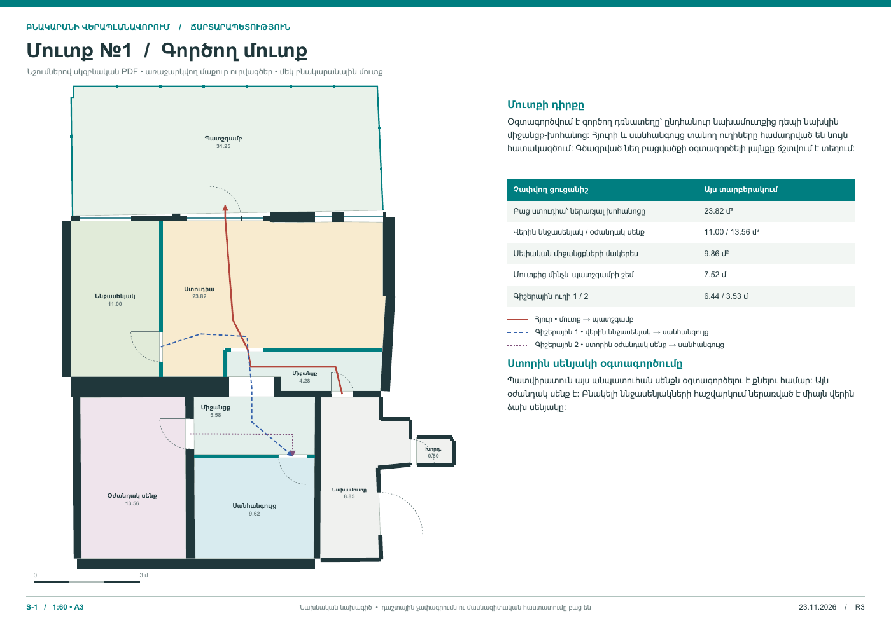
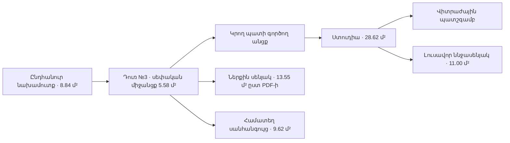
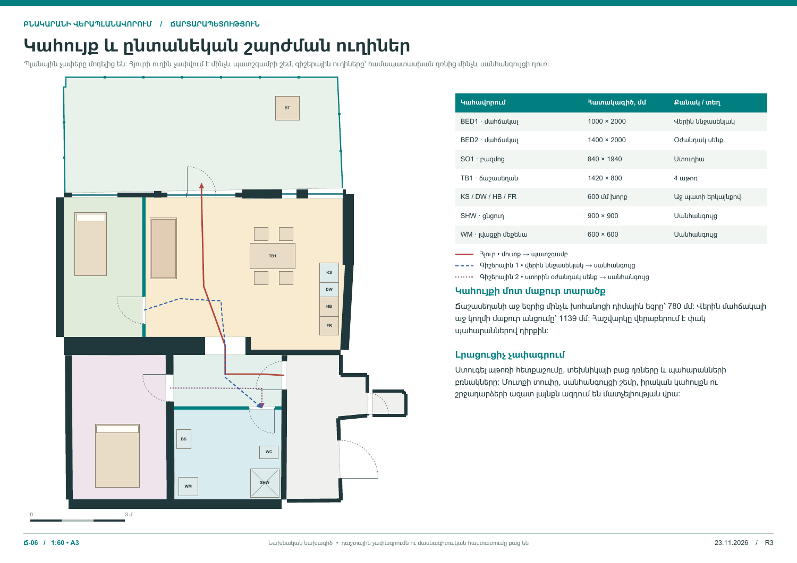
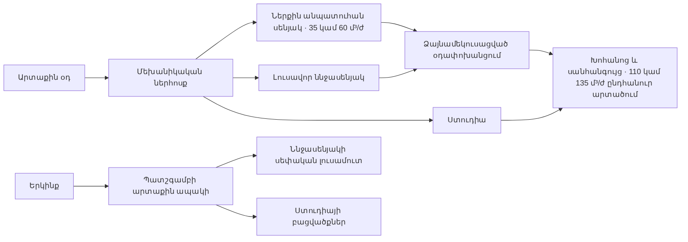
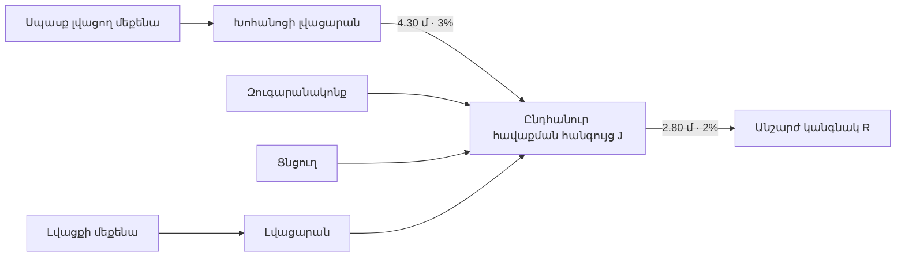
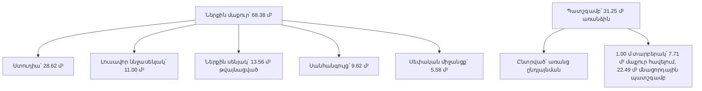

# Մուտքեր, շարժում և ինժեներական կապեր

Երեք տարբերակների չափերը վերցված են նույն PDF-ի բազմանկյուններից։ Մակերեսների և հեռավորությունների համադրությունը թվերով տրված է [նախագծման հիմքերում](DESIGN-BASIS.md)։

| №1 · գործող դուռ | №2 · ստորին դուռ | №3 · ընտրված վերին դուռ |
|---|---|---|
|  |  |  |

## Մուտքից դեպի սենքեր

Հյուրն անցնում է 7.66 մ մինչև պատշգամբի շեմը։ Լուսավոր ննջասենյակի դռնից մինչև սանհանգույցի դուռը 6.44 մ է՝ ստուդիայով։ Ստորին սենյակից նույն ուղին միջանցքով 3.53 մ է։

## Օդ և բնական լույս

## Ինքնահոս ջրահեռացում

Խոհանոցից մինչև կանգնակ ընդհանուր անկումը 185 մմ է։ J հանգույցը պատկերված է ընդհանուր նախամուտքի գոտում և պահանջում է փաստացի նիշերի, հասանելիության ու տեղադրման իրավունքի հաստատում։

## Մակերեսների հաշվեկշիռ

