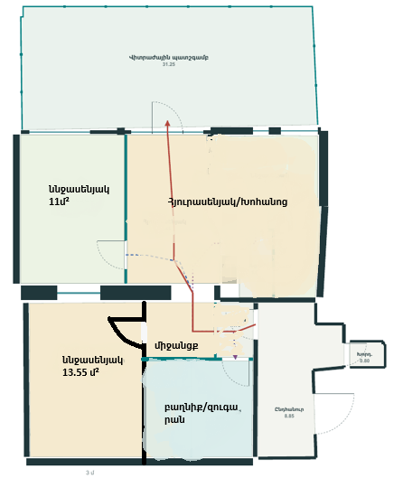

# Պատվիրատուի ընտրված էսքիզը · R3

Պատվիրատուն հաստատել է, որ 13.55 մ² ստորին ձախ սենյակը արտաքին պատուհան չունի և ցանկանում է օգտագործել այն քնելու համար։ Ընտրվել է վերին աջից մուտքը՝ №3։ Ստուդիան ամբողջությամբ տեղավորվում է վերին գոտում։ Հյուրի ուղին ստուդիայից բացվում է դեպի պատշգամբ։

| Էսքիզի նշում | R3-ում չափված կամ ճշտված տվյալ |
|---|---|
| Վերին ձախ 11 մ² | 2.489 × 4.420 մ մաքուր ուղղանկյուն, 11.00 մ²։ |
| Ստորին ձախ 13.55 մ² | Պահպանվել է բնօրինակի ամբողջ սենյակը։ PDF-ի մակագրումը՝ 13.55 մ², բազմանկյունը՝ 13.557 մ²։ Պատուհան չունեցող օժանդակ սենք, անձնական քնելու օգտագործմամբ։ |
| Հյուրասենյակ-խոհանոց | 28.62 մ² մեկ շարունակական սենք, խոհանոցը՝ աջ պատի մոտ։ Արևելյան գծագրված պատերի կառուցվածքային նշանակությունը ճշտվում է նախքան հեռացնելը։ |
| Սեփական միջանցք և սանհանգույց | Համապատասխանաբար 5.58 և 9.62 մ²։ Միջանցքը ելք է տալիս ստորին սենյակ, սանհանգույց և ստուդիա։ |
| Պատշգամբ | Ընտրված է վիտրաժային ապակեպատում գործող սահմանի ներսում։ |
| Կողմնորոշում | Էսքիզը փոխանցում է դասավորության մտահղացումը։ Թվայնացման միակ չափային աղբյուրը նշումներով PDF-ն է։ |

Լուսավոր ննջասենյակն ու ստուդիան բնական լույս են ստանում պատշգամբի կողմից։ Անպատուհան սենքի մեխանիկական ներհոսքն ու արհեստական լուսավորությունը նախատեսված են փակ դռան դեպքում ևս։ Այն բնակելի ննջասենյակ դասակարգելու հիմք չի հաստատվել։ [ՀՀՇՆ 31-01-2014, կետ 178](https://www.arlis.am/hy/acts/208949/latest)
